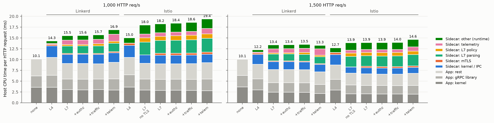
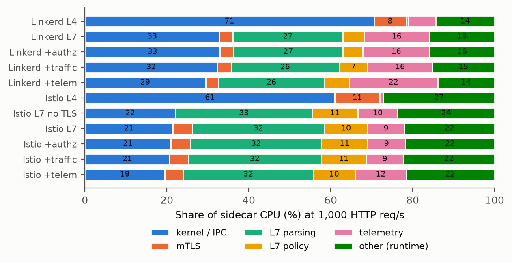
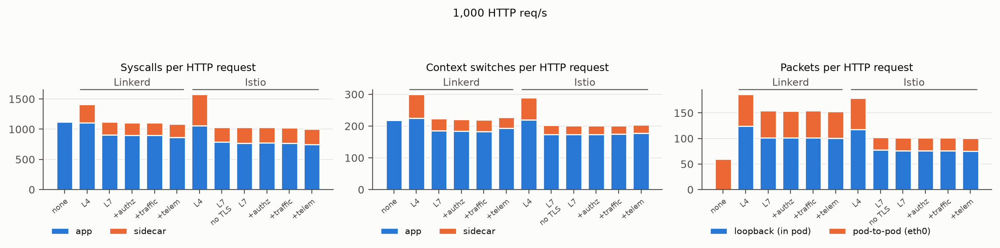

# 실험 1: Online Boutique에서 app container와 sidecar의 CPU overhead 분해

측정일 2026-10-15, rep1 기준(사용자 요청으로 반복은 중단). 그림은 `figs/`, 전체 표는 `tables_rep1.md`,
원자료는 `<config>/rep1/r<rate>/`에 있다. 합의한 기준표 3개는 `TABLES.md`.

## 설정

- **측정 대상:** jet2(Xeon 6515P, 16코어 32스레드)에 Kubernetes pod로 OB 24개를 띄웠다.
  - 배치는 frontend 6, productcatalog 4, currency 2, recommendation 5, 나머지 1개씩이고, 모든 구성이 같다.
  - 앱 컨테이너는 privileged로 host OB 바이너리를 chroot 실행한다. 네트워크(veth, kube-proxy), cgroup, 스케줄링은 Kubernetes 그대로다.
- **CPU:** turbo off, 2.3 GHz 고정, performance governor, SMT on(사용자 결정).
  - 실측 실효 클럭은 2.18–2.23 GHz다(cycles/ref-cycles 0.95–0.97, CPU 간 ±1%).
  - 측정 후 원래 설정(powersave, turbo on)으로 복원했다.
- **부하:** k6를 jet1에서 open-loop로 돌렸다(locustfile 비중). 1,000과 1,500 HTTP req/s다.
  - 2.3 GHz에서 가장 무거운 I5가 2,000 req/s면 큐가 생긴다(p50 33 → 77 ms). 그래서 큐가 없는 최고 두 점을 골랐다.
- **측정점 하나:** warm 15 s → 측정 30 s(cgroup 스냅샷) → `perf record` 10 s(cycles, LBR call stack, cgroup별) → bpftrace 10 s(cgroup별 syscall, context switch).
  - 프로파일러는 측정 구간 밖에서 돌았다.
- **메시:**
  - Linkerd edge-26.8.4: proxy v2.366.0, `linkerd inject --manual`.
  - Istio 1.31.1: minimal, istiod는 jet1, Envoy concurrency 1.
  - 두 메시 모두 공식 sidecar 이미지를 썼다.
- **tracing:** 1% sampling(Istio 기본값, Hindsight의 Jaeger 1% 기준과 동일).
  - 5단계에서는 앱 tracing(parent-based 1%)도 켰다.
  - 그 몫은 `N0t`(sidecar 없이 앱 tracing만)로 따로 쟀다.
- **결과:** 모든 측정점이 실패 0, drop 0이었고, 달성 처리량은 목표의 ±1% 안이다.

## 결과 요약 (1,000 req/s; 괄호는 1,500 req/s)

| 구성 | HTTP 요청당 host CPU | no-sidecar 대비 | sidecar 몫 | p99 |
|---|---:|---:|---:|---:|
| no-sidecar | 10.14 ms (10.09) | — | — | 11 ms |
| Linkerd L4+mTLS | 14.30 (12.25) | +41% (+21%) | 27% | 16 ms |
| Linkerd L7 (기본) | 15.53 (13.39) | +53% (+33%) | 41% (42%) | 25 ms |
| Linkerd +authz / +traffic / +telem | 15.55 / 15.71 / 16.91 | +53% / +55% / +67% | 42–45% | 25–30 ms |
| Istio L4+mTLS | 15.04 (12.73) | +48% (+26%) | 30% | 18 ms |
| Istio L7, mTLS 끔 | 18.00 (13.88) | +78% (+38%) | 49% | 41 ms |
| Istio L7 (기본) | 18.25 (13.94) | +80% (+38%) | 51% (52%) | 43 ms |
| Istio +authz / +traffic / +telem | 18.42 / 18.62 / 19.39 | +82% / +84% / +91% | 51–52% | 44–52 ms |

### Sidecar CPU의 구성 (HTTP 요청당 ms, 1,000 req/s)

| 구성 | kernel/IPC | mTLS | L7 parsing | L7 policy | telemetry | other(runtime) | 합 |
|---|---:|---:|---:|---:|---:|---:|---:|
| Linkerd L4 | 2.67 (70%) | 0.30 | 0 | 0.02 | 0.25 | 0.54 | 3.79 |
| Linkerd L7 | 2.11 (33%) | 0.21 (3%) | 1.73 (27%) | 0.33 (5%) | 1.03 (16%) | 1.02 (16%) | 6.44 |
| Linkerd +telem | 2.22 | 0.23 | 1.96 | 0.45 | 1.62 | 1.05 | 7.53 |
| Istio L4 | 2.76 (61%) | 0.50 | 0 | 0 | 0.04 | 1.23 | 4.53 |
| Istio L7 | 1.98 (21%) | 0.44 (5%) | 2.98 (32%) | 0.97 (11%) | 0.83 (9%) | 2.03 (22%) | 9.22 |
| Istio +telem | 1.97 | 0.46 | 3.20 | 1.04 | 1.26 | 2.18 | 10.11 |

## 관찰

1. **sidecar가 앱+sidecar CPU의 41–52%를 쓴다.** HTTP 요청당 host CPU는 no-sidecar보다 Linkerd가 53%, Istio가 80% 많다(1,000 req/s). 기능을 모두 켜면 67%와 91%다.
2. **L7 파싱·policy·mTLS 세 기능을 합해도 sidecar CPU의 35%(Linkerd)–48%(Istio)다.** 나머지는 다음과 같다.
   - kernel/IPC: 21–33%
   - 프록시 런타임: 16–22%
   - 기본 telemetry: 9–16%
3. **mTLS는 작다.**
   - Istio에서 mTLS를 켠 구성과 끈 구성의 차이는 sidecar 기준 요청당 0.35 ms(sidecar의 3.8%), 앱+sidecar 기준 0.25 ms다. perf 분해의 mTLS 몫도 3–5%다.
   - gRPC 연결이 오래 유지되어 handshake가 거의 없고, 메시지가 작아 레코드 암복호도 작다.
4. **명시적 인가 정책의 추가 비용은 작다.**
   - Linkerd는 요청당 +0.02 ms다. 기본 상태에서도 요청마다 인가를 하고 있었기 때문이다(policy 0.33 ms).
   - Istio는 RBAC filter가 생기면서 +0.17 ms다.
   - rate limit과 retry/timeout은 +0.16–0.20 ms를 더한다.
5. **telemetry는 sidecar 밖에도 비용을 만든다.**
   - Linkerd에서 access log와 tracing을 켜면 sidecar가 요청당 +0.86 ms 늘고, containerd가 +0.9코어 늘어난다(로그 수집).
   - Istio는 sidecar가 +0.57 ms 늘고, containerd는 +0.06코어로 거의 그대로다. Envoy는 access log를 버퍼링해서 몰아 쓰고, Linkerd는 줄마다 쓰기 때문으로 보인다(containerd-shim 샘플 수 2,885 → 2,830 대 3,201 → 5,718).
   - 앱 tracing(1%)은 앱에 +0.54 ms를 더한다.
6. **L4 모드에서는 kernel/IPC가 sidecar CPU의 61–70%다.** MeshInsight(SoCC '23)의 "TCP 모드는 IPC와 read/write가 지배" 결과와 맞는다.
   - L7 모드에서는 파싱이 user 영역 최대 항목(27–32%)이다.
   - 다만 MeshInsight의 63–77%보다 훨씬 작고, kernel/IPC와 런타임이 여전히 크다.
7. **sidecar 커널 시간(요청당 2.1 ms)의 구성** (Linkerd L7, 1,000 req/s): TCP/IP 스택 0.98 ms, 스케줄러(깨어남, 문맥 전환) 0.44 ms, netfilter(iptables redirect) 0.30 ms, epoll/futex 0.10 ms, syscall 진입 0.11 ms.
8. **앱 쪽 "이중 파싱".**
   - 앱의 gRPC 라이브러리가 요청당 2.4–2.6 ms(앱 CPU의 25–28%)를 쓴다. sidecar가 같은 HTTP/2를 다시 파싱한다.
   - sidecar가 있으면 앱의 커널 시간은 3.6 → 2.9–3.1 ms로 준다. pod 간 트래픽을 sidecar가 묶어 보내고, 수신 쪽 softirq가 보내는 쪽 cgroup에 잡히기 때문이다.
9. **커널 상호작용 (요청당).**
   - L7 sidecar는 pod 안 loopback 패킷 75–102개, sidecar syscall 210–260회, context switch 25–38회를 더한다.
   - 대신 앱 syscall이 1,119 → 771–907회로 줄고, pod 간 패킷이 60 → 25–53개로 준다.
   - 그래서 앱+sidecar syscall 합은 L7에서 no-sidecar와 비슷하다(1,031–1,120 대 1,119).
   - L4 모드에서만 크게 는다(+290–460).
10. **부하가 오를수록 메시의 요청당 CPU가 줄어든다** (Istio 18.25 → 13.94 ms). no-sidecar는 10.1 ms로 그대로다. sidecar의 요청당 고정비(깨어남, 이벤트 루프)가 batching으로 상쇄되는 것으로 보인다.
11. **pod cgroup 밖 비용.**
    - 측정 구간에 jet2 전체에서 pod 밖 CPU가 약 3코어다(containerd 약 1코어, control plane, kubelet, 측정 도구).
    - idle이나 ksoftirqd 문맥에서 처리된 네트워크 softirq는 pod cycle의 0.2–0.5%로 무시할 만하다.

## 커널 상호작용 그림

## 주의할 점

- **반복:** 측정은 rep1 한 번이다. rep2에서 끝난 7개 측정점과의 차이는 −0.7%에서 +0.7% 사이다(`tables_rep1.md` F).
- **SMT:** 켜져 있다. 같은 코어의 다른 스레드가 바쁜 정도가 부하에 따라 달라서 CPU 시간에 섞인다.
- **측정 노드:** jet2는 Kubernetes control plane 노드다. apiserver와 etcd가 같은 host에서 돈다(pod 밖 CPU에 포함되고, 요청당 수치에는 들어가지 않는다).
- **제자리 단계와 새 배포:** L3/L4는 L2 pod에, I3/I4는 I2 pod에 정책만 더해서 쟀다. 5단계와 L1, I1, I2n은 새로 배포했다.
  - 1,500 req/s에서 L5의 앱 CPU가 L4보다 0.48 ms 낮다(frontend, productcatalog). syscall 수는 같아서 원인은 확인하지 못했다.
  - 1회 측정이라 배포 사이 편차와 구별할 수 없다.
- **cgroup 귀속:** 수신 쪽 커널 처리가 보내는 쪽 task의 cgroup에 잡힌다. 그래서 앱과 sidecar 사이의 kernel 분할은 귀속이 옮겨 갈 수 있다. 합계는 정확하다.
- **Linkerd mTLS:** 끌 수 없어서 perf 분류로만 쟀다. Istio는 끈 구성과의 차이로 교차 확인했다.
- **기능 설정:** 기능은 트래픽을 바꾸지 않게 걸었다(rate limit 거부 0, fault 0%, timeout 10 s). 따라서 평가 비용만 들어 있다.
- **분류 방법:** perf 분류는 함수 경로 기반이다.
  - 심볼을 못 푼 leaf는 1–3%다.
  - "other"는 프록시 런타임(tokio/libevent, 버퍼, 할당자)과, 범주가 정해지지 않은 공용 코드다.
- **OB 바이너리:**
  - Go 서비스 4개는 DPUMesh main(`ece30c2`)으로 다시 빌드했다. tracing sampling 패치는 환경변수를 줄 때만 동작한다.
  - 나머지는 10-07 빌드다. tcp 모드라 DPUMesh 어댑터는 꺼져 있다.
- **turbo on 결과:** 같은 날 turbo on(기본 설정)으로 잰 결과는 `../overhead-20261015-defaultcpu/`에 따로 둔다.
  - 절대값은 다르다(no-sidecar 8.4 대 10.1 ms/req).
  - 같은 구성 안의 묶음 비율은 ±1%p 안에서 같다.

## 파일

- **하네스:** `../../overhead/`
  - `mk.py`: 구성별 manifest
  - `run.py`: 측정
  - `classify.py`: perf → 6개 묶음
  - `summarize.py`, `plot.py`
  - `cpu.sh`: 클럭 고정과 복원
- **결과:**
  - `summary_rep1.csv`: 구성×부하
  - `summary_all_points.csv`: rep2 일부 포함
  - `tables_rep1.md`: 표 A–F
  - 측정점 디렉터리: `k6.json`, `snap.json`, `bpf.json`, `perf.txt.gz`, `buckets.json`, `meta.json`, `summary.json`
